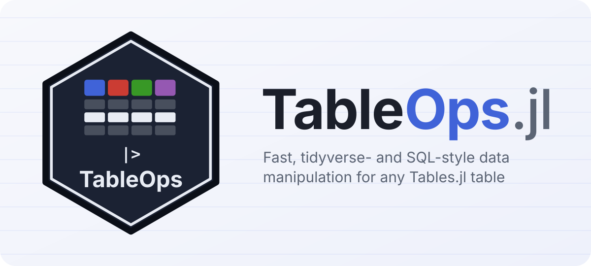

# TableOps.jl

<p align="center">
  <picture>
    <source media="(prefers-color-scheme: dark)"
            srcset="docs/src/assets/readme-banner-dark.svg">
    
  </picture>
</p>

[](https://github.com/Akai01/TableOps.jl/actions/workflows/CI.yml)
[](https://Akai01.github.io/TableOps.jl/dev/)

> **In development.** Nothing is usable yet. This README describes the planned
> API; the full design is in [docs/src/design.md](docs/src/design.md).

Fast, tidyverse- and SQL-style data manipulation for any
[Tables.jl](https://github.com/JuliaData/Tables.jl) table, in pure Julia with
Tables.jl as the only dependency.

```julia
using TableOps

dt = (store = ["A", "A", "B"], date = [1, 2, 1], revenue = [10.0, 20.0, 5.0])

@select(dt, store, date, revenue) |> @group_by(store) |>
    @summarize(store_revenue = sum(revenue))

# The same without macros:
select(dt, :store, :date, :revenue) |> group_by(:store) |>
    summarize(store_revenue = :revenue => sum)
```

- **Familiar verbs** from the tidyverse and SQL: `select`, `where`, `mutate`,
  `group_by`, `summarize`, `arrange`, joins, pivots and more.
- **Three forms of every verb**: table first, pipe, and macro with bare column
  names.
- **Panels**: `PanelTable` knows which columns identify a series and which is
  time, so `lag`, `lead` and rolling windows work per series.
- **Correct by default**: missing values are never dropped silently, many-to-many
  joins must be declared, and every error says how to fix it.
- **Fast**: quick to load, quick on the first call, benchmarked against
  DataFrames.jl.
- **Compatible**: CSV.jl, Arrow.jl, DataFrames.jl and every other Tables.jl
  source or sink work with it.

Julia 1.10 or later. MIT license.
